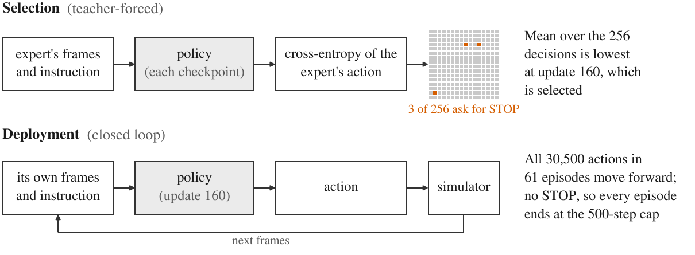
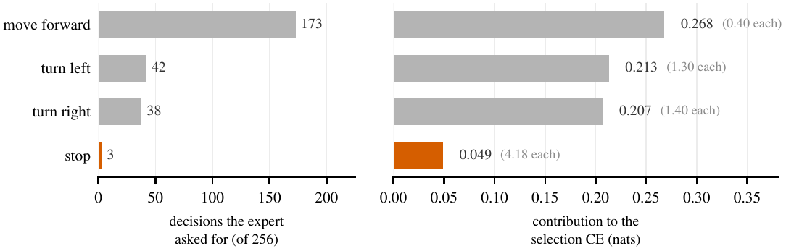
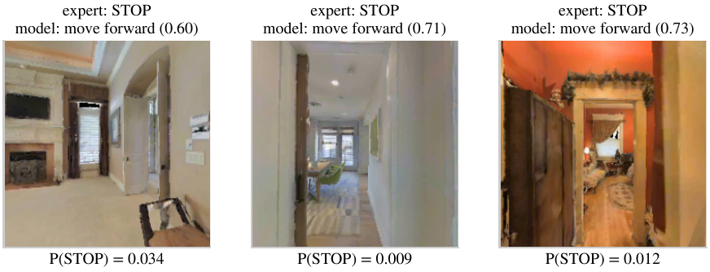
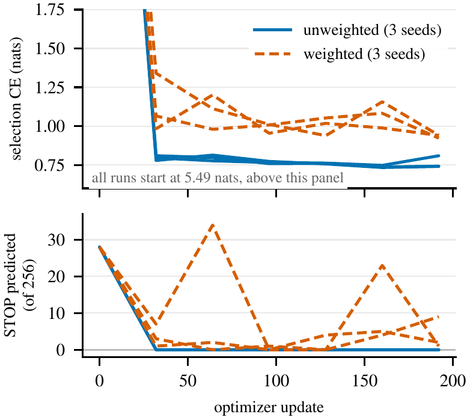
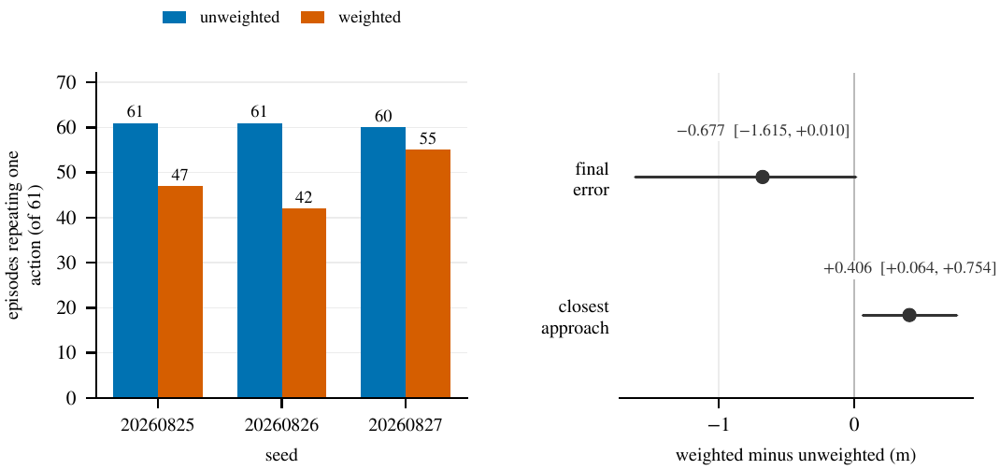
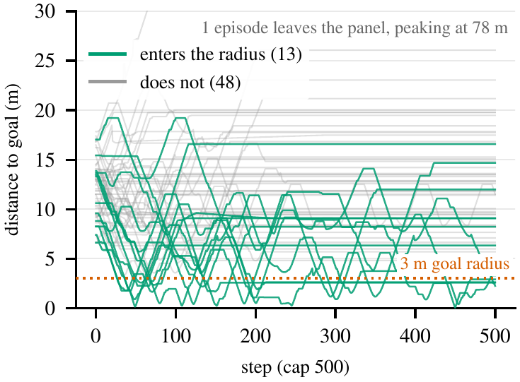

# StopBlind

**What Teacher-Forced Loss Misses: Stopping at the Goal in Fine-Tuned Vision–Language Navigation
Policies**

Vivek Mattam, New York University

Accepted at the [2nd Workshop on Embodied Spatial Reasoning (ESR)](https://embodiedsr.github.io/),
NeurIPS 2026, Sydney (paper track, non-archival).

[Paper (PDF)](paper/main.pdf) · [LaTeX source](paper/) ·
[Preregistration](docs/PREREG_31_CHECKPOINTS.md) · [Run records](artifacts/) ·
[Citation](#citation)

<p align="center">
  
</p>

**Figure 1.** Checkpoint selection compared with deployment, for the unweighted run at seed
20260826. Selection scores 256 held-out decisions with the expert's own past frames supplied and
keeps update 160. In the simulator the same checkpoint sees its own frames, and all 30,500 actions
it takes in 61 episodes are MOVE_FORWARD.

A vision-and-language navigation agent follows a written route instruction through a building,
seeing only its own camera images. An episode counts as a success only if the agent itself stops
within 3 m of the goal. Running every saved checkpoint in a simulator to find one that does this is
expensive, so a general-purpose fine-tuning pipeline can keep the checkpoint with the lowest
validation loss instead. For a navigation policy that loss is teacher-forced: the model sees the
expert's past frames and is scored on whether it predicts the expert's next action.

We fine-tuned Qwen3-VL-8B on Room-to-Room in Continuous Environments (R2R-CE), with and without
class weighting, three seeds each, and ran the checkpoints this loss selected in the Habitat
simulator. None of the six selected checkpoints reaches the goal and stops there. The three trained
without class weighting never press STOP. Two of them take the same actions as a baseline that
always moves forward, and the third differs in one episode. A preregistered follow-up then ran all
37 distinct saved checkpoints, and no checkpoint was shown to navigate better than the selected one.

The loss gives no warning because STOP is rare among the decisions it averages: 3 of the 256 used
to pick the checkpoint. Two offline checks flag every run before it reaches the simulator. One is
recall on STOP; the other is a pass/fail test written down before the first run.

This repository holds the paper, the code that trained and evaluated every policy in it, the
preregistration of the follow-up, and the run records behind its tables and figures.

## Setup

| component | setting |
|---|---|
| Model | Qwen3-VL-8B-Instruct at Hugging Face revision `0c351dd`, frozen in BF16. Only a rank-32 LoRA adapter on the attention projections is trained (30,670,848 parameters). |
| Input and output | The instruction and the last four RGB frames (224 × 224 pixels, 90° field of view, no depth). The model answers with one of four action tokens: STOP, MOVE_FORWARD (0.25 m), TURN_LEFT or TURN_RIGHT (15°). |
| Data | The R2R-CE training split has 197,455 eligible decisions, 66.6% of them MOVE_FORWARD and 1.76% STOP. Training uses 3,072 of them. Three held-out sets come from other trajectories: 256 decisions for selection, 640 in their natural proportions, and 256 balanced at 64 per action. |
| Training | 192 updates of 16 decisions with AdamW at learning rate 2 × 10⁻⁵. Two treatments: plain cross-entropy, and inverse-frequency class weighting, which gives STOP a weight of 10.82 and MOVE_FORWARD 0.379. Seeds 20260825, 20260826 and 20260827. |
| Selection | A checkpoint every 32 updates, from the untrained model at update 0 to update 192. The rule keeps the one with the lowest mean cross-entropy on the selection set. |
| Evaluation | 61 frozen `val_seen` episodes in 53 scenes, the official 500-step cap and a 3 m goal radius, in Habitat-Sim 0.3.3. The evaluator reproduces all 778 released `val_seen` expert trajectories and their official metrics. `val_unseen` was never opened. |

Before any training run, 14 runs of non-learning policies were fixed on the same 61 episodes. Replaying
the expert succeeds on 61 of 61 with SPL 0.9679, and random and handcrafted policies each succeed on
3 of their 305 episodes, so the evaluator does not force zero success.

## Results

### The loss selects a checkpoint that never predicts STOP

In all three unweighted runs the rule keeps update 160 of 192. That checkpoint predicts STOP on none
of the 256 selection decisions, and it recalls none of the 64 STOP decisions in the balanced set.
Its loss is still the lowest in its run. Split by the action the expert took, the selection loss of
the checkpoint picked at seed 20260826 is:

| expert action | decisions | mean CE | contribution | share |
|---|---:|---:|---:|---:|
| move forward | 173 | 0.397 | 0.2681 | 36.4% |
| turn left | 42 | 1.299 | 0.2131 | 28.9% |
| turn right | 38 | 1.395 | 0.2071 | 28.1% |
| **stop** | **3** | **4.180** | **0.0490** | **6.6%** |

The four contributions sum to the selection loss of 0.7373 with no residual. STOP has the worst
cross-entropy of any action, 4.18 against 0.40 for MOVE_FORWARD, and the checkpoint never predicts
it, yet STOP moves only 6.6% of the number that picks the checkpoint. In the other five runs its
share is 3.5–6.2%.

<p align="center">
  
</p>

**Figure 2.** The same decomposition as a chart: how many of the 256 decisions call for each action,
and what each action contributes to the selection loss.

<p align="center">
  
</p>

**Figure 3.** The selected checkpoint (update 160, unweighted seed 20260826) at the three selection
decisions where the expert stops. It chooses MOVE_FORWARD at all three, with probability 0.60 to
0.73, and gives STOP between 0.009 and 0.034. The images are Habitat-Sim renders of Matterport3D
scans (see [Licence](#licence)).

<p align="center">
  
</p>

**Figure 4.** Over training, the loss improves while STOP disappears. Unweighted cross-entropy falls
to about 0.8 within 32 updates and then flattens, while the number of selection decisions the model
calls STOP goes from 28 to zero and never returns. Solid lines are unweighted runs, dashed lines
weighted, three seeds each. Every run starts at 5.49 nats, above the top panel.

### In the simulator

All six selected checkpoints succeed in 0 of 61 episodes, with SPL and SDTW of zero. Each 0/61 is
consistent with a true success rate of up to 5.9% (exact two-sided 95% interval).

| treatment | seed | SR | OSR (episode) | stopped | constant | same as always-forward |
|---|---|---|---|---|---|---|
| unweighted | 20260825 | 0/61 | 1/61 (562) | 0/61 | 61/61 | 61/61 |
| unweighted | 20260826 | 0/61 | 1/61 (562) | 0/61 | 61/61 | 61/61 |
| unweighted | 20260827 | 0/61 | 1/61 (562) | 0/61 | 60/61 | 60/61 |
| weighted | 20260825 | 0/61 | 1/61 (394) | 5/61 | 47/61 | 13/61 |
| weighted | 20260826 | 0/61 | 1/61 (394) | 0/61 | 42/61 | 14/61 |
| weighted | 20260827 | 0/61 | 1/61 (394) | 2/61 | 55/61 | 20/61 |

SR is success rate. OSR, oracle success, counts episodes whose path ever enters the goal radius,
whether or not the agent stops there. "Stopped" episodes end with STOP, "constant" ones repeat one
action from start to finish, and the last column counts episodes whose action sequence is identical
to the always-forward baseline's.

The unweighted policies behave like the always-forward baseline. Seeds 20260825 and 20260826 match
its actions in all 61 episodes. Seed 20260827 matches in 60, and across its 30,500 decisions it
makes 30,499 forward moves and one right turn. Every unweighted episode runs to the 500-step cap. In
episode 562 each unweighted policy walks into the goal radius, makes 480 decisions inside it and
never stops.

Class weighting changes which action is repeated. The weighted policies use all four actions in
aggregate, but in 47, 42 and 55 of their 61 episodes a single action fills the whole rollout. They
press STOP seven times in all, each time outside the goal radius: six times on the first step and
once on step 19, 6.63–12.80 m from the goal. Weighting lowers the mean final distance to the goal
by 0.677 m, mainly because the agent turns in place or stops early instead of moving forward.
Weighted rollouts leave its position unchanged on 94.9–96.1% of steps, and the closest approach to
the goal gets worse by 0.406 m.

<p align="center">
  
</p>

**Figure 6.** Left: episodes in which one action fills the whole rollout. Right: weighted minus
unweighted final error, −0.677 m [−1.615, +0.010], and closest approach, +0.406 m [+0.064, +0.754],
with 95% intervals from resampling the 53 scenes.

### Every saved checkpoint, executed

Both reviewers asked whether the rule passed over a checkpoint that works. To answer, all 37
distinct saved checkpoints were run on the same 61 episodes: the 30 the rule passed over, the
untrained model and the six selected ones again. (The six update-0 files all compute the frozen
base model, because each adapter output matrix in them is exactly zero.) The analysis, and the bar
a checkpoint had to clear, were frozen in [`docs/PREREG_31_CHECKPOINTS.md`](docs/PREREG_31_CHECKPOINTS.md)
on 9 October 2026, before any unselected checkpoint was run or scored. All 2,257 episode runs
completed on NVIDIA L40S GPUs.

| treatment | seed | 32 | 64 | 96 | 128 | 160 | 192 |
|---|---|---|---|---|---|---|---|
| unweighted | 20260825 | 0 (1) | 3 (1) | 0 (1) | 0 (1) | **0 (1)** | 0 (1) |
| unweighted | 20260826 | 8 (0) | 5 (1) | 0 (1) | 0 (1) | **0 (1)** | 0 (1) |
| unweighted | 20260827 | 7 (1) | 0 (1) | 0 (1) | 0 (1) | **0 (1)** | 0 (0) |
| weighted | 20260825 | 3 (0) | 6 (0) | 0 (1) | 4 (0) | 8 (1) | **5 (1)** |
| weighted | 20260826 | 22 (0) | 42 (0) | 0 (0) | **0 (1)** | 1 (0) | 6 (1) |
| weighted | 20260827 | 25 (0) | 0 (0) | 0 (2) | 0 (1) | 15 (0) | **3 (0)** |

STOP presses per checkpoint, by update, with oracle successes in parentheses. Bold marks the
selection rule's pick, run again. Update 0, the untrained model, is shared by all six runs: it
succeeds in 1 of 61 episodes, enters the goal radius in 1 and presses STOP 50 times.

The only success among the 37 policies is the untrained model's, in episode 358. Against each
selected checkpoint that gives p = 0.5 on the preregistered test, so it is not counted as better,
and no candidate reached the bar for a confirmation run. Each of the 36 trained checkpoints succeeds
in 0 of 61 episodes. With all 37 bounded together (one-sided, Bonferroni), each trained
checkpoint's 0 of 61 is consistent with a true success rate of up to 10.3%, and the untrained
model's 1 of 61 with up to 13.7%.

Two preregistered predictions failed. The first was that choosing each run's checkpoint by the lowest
balanced-set loss would beat the averaged loss. Its picks solve no episode, and neither does keeping
each run's last checkpoint, so the balanced loss flags the failure without finding a better
checkpoint. The second was that the 15 unselected trained unweighted checkpoints, which predict STOP
on none of the 256 selection decisions, would never press it in the simulator. Four of them pressed
it 23 times, all on the first step, 6.6–12.9 m from the goal. A zero count of STOP predictions offline
does not mean zero STOP presses in closed loop.

The six selected checkpoints ran first on an NVIDIA GB10 and again here on L40S GPUs. Of their 366
episodes, 347 have identical action sequences. Each of the other 19 first differs at a decision the
GB10 won by 0.125 nats or less, so the two machines agree up to near-ties. The comparison cannot
say why they differ there, because the GPU, its kernels, the renderer and the runner code all
changed at once.

The follow-up has limited power. Under the preregistered design, a checkpoint with a true success
rate of 10% would have been confirmed with probability about 0.52, and one at 15% with probability
about 0.91. It cannot rule out modest gains over the selected checkpoint.

### Offline checks that do warn

Two per-class checks flag every selected run before any simulator run. One is recall on STOP in the
balanced set. The other is the existence gate, fixed before the first run, which asks whether a
model has learned more than how often each action occurs. It passes only if all three of these hold:

1. the natural-set loss is below H − 0.05, where H = 0.9247 nats is the loss of always predicting
   the training action frequencies;
2. the balanced-set loss is below ln 4 − 0.05, where ln 4 = 1.3863 is the loss of a uniform guess;
3. balanced STOP recall is at least 0.25.

The first two are judged by the upper end of a 95% interval from resampling scenes.

| metric | unweighted | weighted | paired delta |
|---|---|---|---|
| natural mean CE ↓ | 0.754 ± 0.012 | 0.955 ± 0.016 | 0.201 ± 0.019 |
| balanced mean CE ↓ | 1.725 ± 0.117 | 1.452 ± 0.132 | −0.273 ± 0.223 |
| balanced accuracy ↑ | 0.332 ± 0.004 | 0.397 ± 0.038 | 0.065 ± 0.042 |
| balanced STOP recall ↑ | 0/64 in 3/3 seeds | 12/64, 1/64, 6/64 | 0.099 ± 0.086 |
| existence gate | 0/3 passed | 0/3 passed | |

Mean ± sample standard deviation over three seeds. Deltas are weighted minus unweighted.

All six selected runs fail the gate, and so do all 37 policies of the follow-up. Class weighting
improves the balanced-set loss, accuracy and STOP recall in all three pairs, but worsens the
natural-set loss in all three. Every trained policy here fails in the simulator, so how often these
checks would flag a policy that navigates, and whether passing them predicts success, is untested.

### Exploratory probes

Three single-seed probes target other possible causes of the collapse. One trains the model to
predict a chunk of four actions at a time, which makes a constant guess much less rewarding. One
scales the data to 40,000 and then 134,754 decisions. One adds a branch that feeds metric 3D
geometry, computed from the simulator's depth, to the model. With chunks, constant-action episodes
fall from 61 of 61 to 39 of 61. None of the probes can test stopping, because their data loader
dropped every decision whose target was STOP. STOP then appeared in training only as the fourth
action of a chunk.

<p align="center">
  
</p>

**Figure 5.** Distance to the goal over the 500-step cap in the 61 episodes of the 134,754-decision
probe. Thirteen episodes enter the 3 m radius (green) and none ends with STOP. The probe's loader
had dropped every STOP decision, so this is not evidence about stopping.

## What the study does and does not show

The study covers one model, one training budget of 192 updates, one learning rate and history
length, three seeds per treatment, and 61 episodes from `val_seen`, a split whose buildings also
appear in training. It makes no claim about unseen buildings and no leaderboard claim. It tests one
remedy, inverse-frequency class weighting. It does not test the inflection weighting of the VLN-CE
baseline, a dedicated stopping head or data rebalancing.

The mechanism is not new. Xiang et al. (2020) pointed out that an unweighted loss gives STOP too
little attention, and Wijmans et al. (2019) warned that navigation policies can reach very high
validation accuracy on action prediction while missing every change of action. This paper adds a
measurement in one setting: which checkpoint the loss selects for a vision–language policy in
continuous R2R-CE, and whether it passed over a better one.

## Repository layout

```
paper/                          camera-ready LaTeX source, figures, tables and compiled PDF
docs/PREREG_31_CHECKPOINTS.md   preregistration of the 37-checkpoint follow-up
docs/figures/                   PNG copies of the paper's figures, for this page
src/spatialvlm/                 the library: backbone, data, evaluation, training
scripts/                        training, evaluation, sweep, analysis, figure and table scripts
tests/                          unit tests
artifacts/spark/                result, manifest and verification records of the training runs,
                                the first closed-loop evaluation and the probes
artifacts/context/              derived analyses cited by the paper
artifacts/torch/                the follow-up: its preregistered analysis of all 37 checkpoints
                                (analysis_v1/) and the test run made before the freeze
                                (stopblind_smoke/)
MANIFEST.sha256                 SHA-256 of every file in this release
```

Where each result comes from:

| result | run records, then the script that made them |
|---|---|
| unweighted run, seed 20260825 | `artifacts/spark/native_c0_development_v1/`<br>`scripts/run_spark_native_c0_development.py` |
| weighted run, seed 20260825 | `artifacts/spark/native_c0_action_balance_v1/`<br>`scripts/run_spark_native_c0_action_balance.py` |
| both treatments, seeds 20260826 and 20260827 | `artifacts/spark/native_c0_seed_replication_*_v1/`<br>`scripts/run_spark_native_c0_seed_replication.py` |
| seed comparison (Table 1 of the paper) | `artifacts/context/native_c0_seed_replication_analysis_v1/`<br>`scripts/analyze_native_c0_seed_replication.py` |
| simulator runs of the six selected checkpoints (Table 2) | `artifacts/spark/native_c0_closed_loop_v1/`<br>`artifacts/context/native_c0_closed_loop_analysis_v1/`<br>`scripts/run_spark_native_c0_closed_loop.py`<br>`scripts/analyze_native_c0_closed_loop.py` |
| the 37-checkpoint follow-up (Table 4, Appendix F) | `artifacts/torch/analysis_v1/`<br>`scripts/score_native_c0_offline.py` (offline scores)<br>`scripts/run_spark_native_c0_checkpoint_sweep.py` (simulator runs)<br>`scripts/analyze_native_c0_checkpoint_sweep.py` (preregistered analysis) |
| probes (Section 5) | `artifacts/spark/native_chunk_*/` |
| Figures 1 to 6 | `scripts/generate_p1_figures.py`, from the records above |

## Reproducing

### Checking the paper against the records

These commands need Python 3.10 or later and matplotlib, but no GPU and no dataset:

```bash
sha256sum -c MANIFEST.sha256
python3 scripts/check_paper_claims.py
python3 scripts/generate_stopblind_sweep_assets.py --out /tmp/table4.tex
python3 scripts/generate_p1_figures.py --out /tmp/figures
```

The first confirms that every file is the one released. The second checks two values in the paper
against the records and confirms that every generated macro the paper uses is defined. The full
claim check used for the paper also reads the per-episode closed-loop traces, which are not
included. Apart from LaTeX comments, the Table 4 output matches `paper/tables/native_c0_sweep.tex`.
The figure script rebuilds Figures 1, 2, 4 and 6 with the same numbers and labels; their layout can
differ slightly with the plotting library's version. Figure 3 needs the rendered frames and Figure 5
the per-episode traces, and neither is released.

In our Habitat-Sim 0.3.3 container, `PYTHONPATH=src:. python3 -m pytest -q tests/` gives 651
passed and 33 skipped.

### Running the experiments again

Training and closed-loop evaluation need a GPU, Qwen3-VL-8B-Instruct at Hugging Face revision
`0c351dd01ed87e9c1b53cbc748cba10e6187ff3b`, Habitat-Sim 0.3.3, the Matterport3D scans and the
R2R-CE episodes. Each dataset comes from its own distributor under its own terms. The entry points
are the scripts in the table above, and `--help` lists each one's arguments. The launch scripts read
their data and cache locations from environment variables and default to folders under `$HOME`.

Training and the first closed-loop evaluation ran on one NVIDIA GB10 GPU (aarch64). The follow-up
ran on NVIDIA L40S GPUs (driver 610.43.02) in an Apptainer image of NVIDIA's PyTorch 25.10
container (torch 2.9.0a0, transformers 4.57.6, peft 0.18.1, habitat-sim 0.3.3). Some stored
decisions are exact BF16 ties (Appendix C of the paper), so another GPU model can change individual
actions.

## The preregistration

The protocol in `docs/PREREG_31_CHECKPOINTS.md` was frozen in version control on 9 October 2026,
before any unselected checkpoint was executed or scored. It was not filed with a public registry.
The analysis output records the protocol's SHA-256 (`inputs.preregistration_sha256` in
`artifacts/torch/analysis_v1/analysis_main.json`). The follow-up's run records list the SHA-256 of
the 68 code files it ran, and the copies of those files in `src/` and `scripts/` are byte-identical
to them. `analysis_main.json` holds, for every one of the 37 checkpoints, the offline criteria, the
closed-loop outcomes and the preregistered tests.

## Redactions

Three files differ from the originals by an internal name or a local path. Nothing else in them is
changed.

- `docs/PREREG_31_CHECKPOINTS.md`: an internal reviewer's name and a local folder path. The
  original's SHA-256 is `0419b7bd6022056ae469077254aa2d620d560502035e0de13cfb853bd83c74e4`.
- `artifacts/torch/analysis_v1/analysis_main.json`: an internal reviewer's name in one listed file
  name. The original's SHA-256 is `e9561497e7583e9e7fdb2a61532248e6d89db9e15d1851814899ac08df10e161`.
- `scripts/analyze_native_c0_checkpoint_sweep.py`: an internal reviewer's name in one comment. The
  original's SHA-256 is `39871d591ec8031b8401d05619dd962393d3fccc3d3764108be7613727931949`.

Code comments and the protocol refer to internal review entries (`CR-0xx`) and to documents that
are not part of this release. Some records in `artifacts/context/` keep the local paths they were
written with.

## Not included

- Model checkpoints and cached training inputs. They are derived from Matterport3D scans and are not
  distributed here.
- Per-episode closed-loop traces: about 1 GB for the first evaluation and 5.5 GB for the follow-up.
  The aggregate results and manifests are included, and the traces are available from the author on
  request.
- The scripts that submitted the follow-up to the cluster. The run records name the GPU, its driver
  and the container image's SHA-256.
- A second, unpublished study that shares this codebase. Its runs, scripts and manuscript are left
  out, and nothing here depends on them.

## Citation

```bibtex
@inproceedings{mattam2026stopblind,
  title     = {What Teacher-Forced Loss Misses: Stopping at the Goal in Fine-Tuned
               Vision--Language Navigation Policies},
  author    = {Mattam, Vivek},
  booktitle = {2nd Workshop on Embodied Spatial Reasoning, NeurIPS},
  year      = {2026},
  note      = {Non-archival}
}
```

## Licence

The code, and the text written for this project, are under the MIT licence (`LICENSE`), with two
exceptions.

- **Material derived from Matterport3D.** Every episode ran in a Matterport3D scan, so the run
  records in `artifacts/`, and the figures and tables made from them, are information derived from
  the Matterport3D dataset. So are the three camera frames rendered from a scan in Figure 3
  (`paper/figures/p1_stop_moments.pdf`, `docs/figures/p1_stop_moments.png` and `paper/main.pdf`).
  The MIT licence does not cover this material. It is released for non-commercial academic use
  only, under the
  [Matterport End User License Agreement for Academic Use of Model Data](https://kaldir.vc.in.tum.de/matterport/MP_TOS.pdf).
- `paper/neurips_2026.sty` is the NeurIPS style file, included only so that the paper compiles.

## Acknowledgments

This work was supported in part through the NYU IT High Performance Computing resources, services,
and staff expertise.

## Contact

Vivek Mattam, vm2677@nyu.edu. Questions and corrections are welcome, here as issues or by email.
